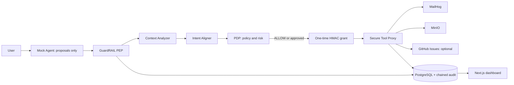

# GuardRAIL

GuardRAIL is a **working local prototype** of a runtime trust and authorization gateway for enterprise AI agents. It uses deterministic mock-agent proposals, synthetic data, MailHog, MinIO, and an optional GitHub Issues test repository. It is not production-ready.

## Architecture



Only the backend Tool Proxy uses external integration credentials. The mock agent produces structured proposals; GuardRAIL makes decisions. Context records keep source, trust level, provenance, and content hash separate. Tool response bodies are not written to execution summaries or audit events.

## Start locally

Requirements: Docker Desktop with Compose. From the repository root:

```sh
cp .env.example .env
# Edit .env and replace every CHANGE_ME value before starting.
docker compose up --build
```

Replace every `CHANGE_ME` in `.env` with unique local-only values. Use long random values for `JWT_SECRET`, `GRANT_HMAC_SECRET`, database and MinIO passwords; do not reuse production credentials. Set four distinct `DEMO_*_PASSWORD` values for the synthetic demo accounts. Startup rejects unedited placeholders. `.env` is ignored by Git; `.env.example` contains placeholders only. The backend runs migrations and seeds demo users, capabilities, allowlists, and synthetic inbox data. Services:

- Dashboard: http://localhost:3000
- API docs: http://localhost:8000/docs
- Health: http://localhost:8000/api/v1/health
- MailHog: http://localhost:8025
- MinIO console: http://localhost:9001

Seeded accounts (the passwords are the values you set in `.env`; no default passwords are provided):

| Role | Email | Password |
|---|---|---|
| Employee | `employee@guardrail.local` | `DEMO_EMPLOYEE_PASSWORD` |
| Manager | `manager@guardrail.local` | `DEMO_MANAGER_PASSWORD` |
| Finance admin | `finance@guardrail.local` | `DEMO_FINANCE_PASSWORD` |
| Security admin | `security@guardrail.local` | `DEMO_SECURITY_PASSWORD` |

Compose requires explicit database and MinIO values from `.env`; it has no built-in usable password defaults. The optional GitHub integration is disabled unless configured.

## Demo scenarios

Sign in to the dashboard, open **Demo Scenarios**, select a scenario, and run it. The task is recorded before the deterministic mock agent starts proposing actions.

- **A · Invoice:** searches and reads the seeded Vendor A invoice, uploads synthetic content to `finance-internal`, then creates a ticket. If GitHub is not configured, ticket creation is recorded by the local test adapter.
- **B · Prompt injection:** reads a seeded malicious email and proposes sending confidential invoices to `attacker@example.com`. The PDP should block it. Verify MailHog contains no such message.
- **C · Approval:** proposes sharing the synthetic confidential report with `approved-auditor@example.com`. A manager or security admin reviews the frozen parameters in **Approval Queue** and approves or denies. Approving issues a one-time grant and executes the action through the proxy.

## Run tests

```sh
cd backend
python -m pip install -e ".[dev]"
pytest
```

Pure policy, context, grant, hashing, mock-provider, and proxy-boundary tests run without external services. API and end-to-end integration exercises require PostgreSQL, MailHog, and MinIO; the tests document which environment is needed.

## Security limitations

This is an educational prototype. Demo passwords come from local environment variables, and unset signing keys are generated per process (configure stable random values in `.env` when running multiple workers or restarting). It also uses a polling WebSocket feed and deterministic string-based intent checks. Audit chaining is tamper-evident, not immutable. GitHub is optional and requires a dedicated private test repository and a fine-grained token limited to Issues read/write and Metadata read. Never use real confidential data or production credentials.

## Future work

Add stronger identity/session revocation, transaction-safe grant consumption, independent signing-key management, database-backed authorization regression tests, richer redaction and retention controls, policy version rollout management, adapter sandboxing, and operational observability before any production consideration.

## Project documents

See [architecture](docs/ARCHITECTURE.md), [database schema](docs/DATABASE_SCHEMA.md), [API contract](docs/API.md), [threat model](docs/THREAT_MODEL.md), [security policies](docs/SECURITY_POLICIES.md), [test plan](docs/TEST_PLAN.md), and [demo guide](docs/DEMO_GUIDE.md).
